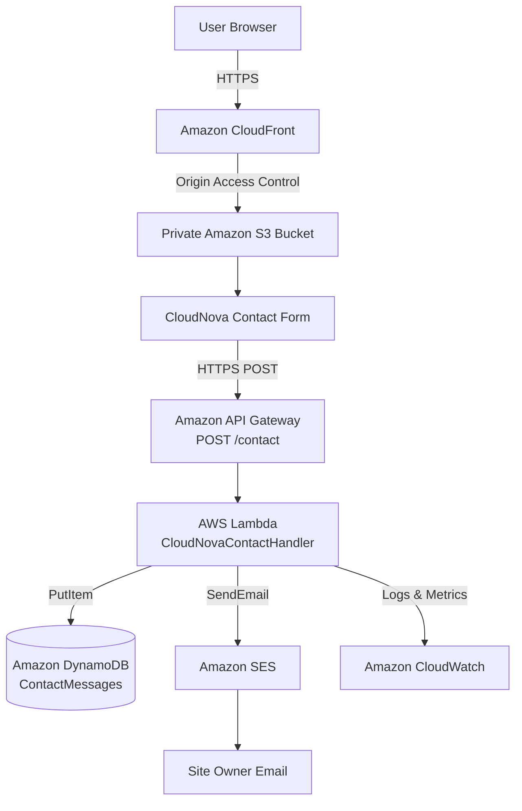

# Serverless Lead Capture on AWS

A hands-on AWS serverless project that hosts a static website securely using Amazon S3 and CloudFront and provides a fully serverless backend for processing contact enquiries.

The application used for this project is **CloudNova**, a fictional cloud and software services website built with HTML, CSS, and JavaScript.

## Project Status

**Completed core architecture**

The application currently supports:

- Static website hosting using Amazon S3
- HTTPS content delivery through CloudFront
- Private S3 origin using Origin Access Control
- Dynamic contact form submission
- HTTP API using Amazon API Gateway
- Serverless backend processing using AWS Lambda
- Lead persistence in Amazon DynamoDB
- Owner email notifications through Amazon SES
- Lambda monitoring and logs through Amazon CloudWatch
- Least-privilege IAM permissions

Customer acknowledgement emails are planned after Amazon SES production access is enabled.

---

## Architecture



---

## AWS Region

Regional resources are deployed in:

```text
Asia Pacific (Sydney)
ap-southeast-2
```

Regional services:

- Amazon S3
- AWS Lambda
- Amazon API Gateway
- Amazon DynamoDB
- Amazon SES
- Amazon CloudWatch

Amazon CloudFront is a global AWS service.

Route 53 and a custom domain are not currently used. The project uses the default CloudFront HTTPS domain.

---

# Application Flow

When a visitor submits the CloudNova contact form:

```text
Visitor
   |
   v
CloudFront
   |
   v
Private S3
   |
   v
JavaScript Contact Form
   |
   | POST /contact
   v
API Gateway
   |
   v
Lambda
   |
   +-----------------------+
   |                       |
   v                       v
DynamoDB                  SES
Store enquiry       Send owner email
   |
   v
CloudWatch
Logs / Metrics
```

Lambda:

1. Receives the request
2. Parses the submitted JSON
3. Validates required fields
4. Generates a UUID
5. Adds a timestamp
6. Saves the enquiry in DynamoDB
7. Sends an email notification to the site owner
8. Returns a success response containing the enquiry ID

The frontend then displays the generated reference ID to the visitor.

---

# AWS Services Used

| AWS Service | Purpose |
|---|---|
| Amazon S3 | Stores HTML, CSS and JavaScript |
| Amazon CloudFront | CDN, HTTPS and secure frontend delivery |
| Origin Access Control | Allows CloudFront to securely access private S3 |
| API Gateway | Provides the public HTTP API |
| AWS Lambda | Executes serverless backend logic |
| Amazon DynamoDB | Stores contact enquiries |
| Amazon SES | Sends owner email notifications |
| AWS IAM | Controls service permissions |
| Amazon CloudWatch | Logs and monitors Lambda executions |

---

# Why Serverless?

A contact form is an event-driven workload.

The backend does not need to run continuously.

Example:

```text
No form submission
        |
        v
No Lambda execution


Form submitted
        |
        v
Lambda executes
        |
        v
Processing completes
        |
        v
Execution ends
```

A continuously running EC2 server would require maintaining compute resources even when no visitors are submitting forms.

With Lambda, backend code runs only when required.

## Server-Based Approach

```text
EC2
 |
Operating System
 |
Web/Application Server
 |
Backend Runtime
 |
Application
```

The developer may need to manage:

- Operating system updates
- Security patches
- Web server configuration
- Runtime configuration
- Capacity
- Scaling
- Availability

## Serverless Approach

```text
API Gateway
     |
     v
Lambda
```

AWS manages most of the underlying compute infrastructure.

The developer mainly manages:

- Application code
- Configuration
- IAM permissions
- Business logic

---

# Event-Driven Architecture

The project is event-driven because processing begins when an event occurs.

For CloudNova:

```text
Contact form submitted
        |
        v
API Gateway receives request
        |
        v
Lambda is triggered
        |
        +---- Save enquiry
        |
        +---- Send email
```

The form submission is the event.

---

# Amazon S3

S3 stores the static deployment files:

```text
cloudnova-deploy/
├── index.html
├── css/
│   └── style.css
└── js/
    └── contact.js
```

The bucket is private.

## Why S3 Instead of EC2?

CloudNova's frontend consists only of:

- HTML
- CSS
- JavaScript

It does not require a continuously running application server.

### Advantages

- No server management
- Highly scalable
- Durable object storage
- Simple static asset deployment
- Integrates directly with CloudFront

### Disadvantages

- Cannot execute backend application code
- Dynamic operations require additional services
- Not a traditional filesystem/application server

---

# Amazon CloudFront

CloudFront is the public entry point for the website.

```text
Internet
   |
   v
CloudFront
   |
   v
Private S3
```

CloudFront provides:

- HTTPS
- Content caching
- Global edge delivery
- Secure access to S3
- Reduced direct access to the origin

## Origin Access Control

Origin Access Control allows CloudFront to access the private S3 bucket without exposing that bucket directly to the public internet.

---

# API Gateway

CloudNova uses an HTTP API.

Route:

```text
POST /contact
```

API Gateway receives requests from the frontend and forwards them to Lambda.

```text
contact.js
    |
    v
API Gateway
    |
    v
Lambda
```

## Why API Gateway?

The browser needs a secure HTTP endpoint to invoke backend functionality.

### Advantages

- Fully managed API service
- HTTPS endpoints
- Lambda integration
- CORS support
- Automatic scaling

### Disadvantages

- Additional configuration
- CORS must be configured correctly
- Adds another distributed component to debug

---

# AWS Lambda

Lambda function:

```text
CloudNovaContactHandler
```

Responsibilities:

```text
Receive request
      |
Validate fields
      |
Generate UUID
      |
Add timestamp
      |
Store enquiry
      |
Send notification
      |
Return response
```

## Why Lambda Instead of EC2?

The function executes only when the form is submitted.

This makes Lambda suitable for:

- Event-driven workloads
- Intermittent traffic
- Short backend operations
- Automatic scaling

### Advantages

- No server management
- Automatic scaling
- Event-driven execution
- Usage-based pricing
- Native AWS integrations

### Disadvantages

- Cold starts can occur
- Execution limits exist
- Functions are stateless
- Distributed debugging can be more complex

---

# Amazon DynamoDB

Table:

```text
ContactMessages
```

Partition key:

```text
id
```

Example item:

```json
{
  "id": "generated-uuid",
  "name": "Example User",
  "email": "user@example.com",
  "phone": "9876543210",
  "message": "I need help with AWS deployment.",
  "createdAt": "2026-11-05T10:30:00.000Z"
}
```

## Why DynamoDB Instead of RDS?

Each enquiry is an independent record.

The application does not currently require:

- SQL joins
- Foreign keys
- Complex relational queries
- Multi-table transactions

DynamoDB therefore provides a simple serverless persistence layer.

### Advantages

- Fully managed
- Serverless
- Automatically scalable
- Fast key-based operations
- Integrates naturally with Lambda

### Disadvantages

- No relational joins
- Different data modelling approach from SQL
- Complex querying can require additional design

---

# Amazon SES

Amazon Simple Email Service sends an owner notification whenever someone submits the contact form.

Current workflow:

```text
Lambda
  |
  v
Amazon SES
  |
  v
CloudNova Owner
```

The email contains:

- Visitor name
- Visitor email
- Phone number
- Message
- Enquiry ID
- Submission timestamp

The visitor's email is configured as the Reply-To address, allowing the owner to reply directly to the enquiry.

## Customer Confirmation Emails

Customer confirmation emails are planned after SES production access is enabled.

Current SES sandbox restrictions prevent arbitrary unverified recipient addresses from receiving messages.

---

# AWS IAM

Lambda uses:

```text
CloudNovaContactLambdaRole
```

Policies:

```text
AWSLambdaBasicExecutionRole
CloudNovaContactLambdaPolicy
```

The custom policy grants only the permissions required by the function:

```text
dynamodb:PutItem
ses:SendEmail
```

This follows the principle of least privilege.

Lambda does not receive unnecessary permissions such as:

```text
s3:DeleteBucket
ec2:RunInstances
dynamodb:DeleteTable
```

---

# Amazon CloudWatch

CloudWatch provides observability for the backend.

Lambda logs are written to:

```text
/aws/lambda/CloudNovaContactHandler
```

CloudWatch helps monitor:

- Function invocations
- Errors
- Execution duration
- Request processing
- Application logs

This allows backend failures to be diagnosed without accessing a server directly.

---

# Security Design

The project applies several basic cloud security practices:

- S3 Block Public Access enabled
- S3 accessible through CloudFront OAC
- HTTPS frontend delivery
- HTTPS API endpoint
- Least-privilege Lambda IAM role
- No AWS credentials stored in frontend JavaScript
- SES sender identity verified
- DynamoDB not exposed directly to the browser
- Backend resources accessed through Lambda

---

# Static vs Dynamic Content

## Static

Delivered from S3 through CloudFront:

- Home
- Services
- Projects
- About
- Contact form interface

## Dynamic

Processed through the serverless backend:

- Contact form submission
- Input validation
- UUID generation
- Timestamp generation
- DynamoDB persistence
- SES email notification
- API response
- Reference ID displayed to the user

---

# Deployment Process

```text
Develop frontend locally
        |
        v
Create deployment bundle
        |
        v
Upload to S3
        |
        v
CloudFront distribution
        |
        v
Create DynamoDB table
        |
        v
Verify SES identity
        |
        v
Create IAM role
        |
        v
Create Lambda
        |
        v
Test Lambda
        |
        v
Create API Gateway HTTP API
        |
        v
Configure POST /contact
        |
        v
Configure CORS
        |
        v
Update contact.js
        |
        v
Upload updated JavaScript
        |
        v
Invalidate CloudFront cache
        |
        v
End-to-end testing
```

---

# Screenshots

| Screenshot | Description |
|---|---|
| `01-cloudfront-live-site.png` | CloudNova running through CloudFront |
| `02-s3-private-bucket.png` | Static files stored in private S3 |
| `03-cloudfront-distribution.png` | CloudFront distribution configuration |
| `04-dynamodb-table.png` | ContactMessages table and stored enquiry |
| `05-ses-verified-identity.png` | Verified SES identity |
| `06-lambda-function.png` | CloudNovaContactHandler |
| `07-api-gateway-route.png` | POST /contact route |
| `08-cloudwatch-logs.png` | Lambda CloudWatch log stream |
| `09-live-form-success.png` | Successful live enquiry with reference ID |

---

# Repository Structure

```text
01-Serverless-Lead-Capture/
├── README.md
│
├── architecture/
│   └── architecture.md
│
├── deployment/
│   └── deployment-notes.md
│
└── screenshots/
    ├── 01-cloudfront-live-site.png
    ├── 02-s3-private-bucket.png
    ├── 03-cloudfront-distribution.png
    ├── 04-dynamodb-table.png
    ├── 05-ses-verified-identity.png
    ├── 06-lambda-function.png
    ├── 07-api-gateway-route.png
    ├── 08-cloudwatch-logs.png
    └── 09-live-form-success.png
```

---

# Completed Features

- [x] Build CloudNova frontend
- [x] Test website locally
- [x] Create deployment bundle
- [x] Create private S3 bucket
- [x] Upload frontend to S3
- [x] Configure CloudFront
- [x] Configure Origin Access Control
- [x] Serve website over HTTPS
- [x] Create DynamoDB ContactMessages table
- [x] Verify SES owner identity
- [x] Create Lambda IAM role
- [x] Apply least-privilege permissions
- [x] Create Lambda contact handler
- [x] Store enquiries in DynamoDB
- [x] Send owner notification using SES
- [x] Verify CloudWatch logging
- [x] Create API Gateway HTTP API
- [x] Create POST /contact
- [x] Configure CORS
- [x] Integrate API Gateway with Lambda
- [x] Test API independently
- [x] Connect frontend using Fetch API
- [x] Deploy updated JavaScript
- [x] Invalidate CloudFront cache
- [x] Perform end-to-end testing

---

# Planned Improvements

- [ ] Request SES production access
- [ ] Send acknowledgement emails to customers
- [ ] Restrict CORS further if deployment URL changes
- [ ] Add CloudWatch alarm for Lambda errors
- [ ] Improve email authentication using a custom domain if one is added later
- [ ] Add infrastructure as code using Terraform or AWS CloudFormation

---

# Key Learning Outcomes

This project demonstrates practical understanding of:

- AWS serverless architecture
- Event-driven systems
- S3 object storage
- CloudFront CDN
- Origin Access Control
- API Gateway
- Lambda
- DynamoDB
- SES
- IAM roles and policies
- CloudWatch
- CORS
- HTTPS
- Static vs dynamic applications
- Server vs serverless architecture
- Least-privilege security
- End-to-end cloud deployment

---

## Final Architecture Summary

```text
CloudFront
    |
Private S3
    |
CloudNova Frontend
    |
API Gateway
    |
Lambda
   / \
  /   \
DDB   SES
 |
CloudWatch
```

CloudNova demonstrates how a simple static application can be extended into a scalable, event-driven serverless application using managed AWS services.